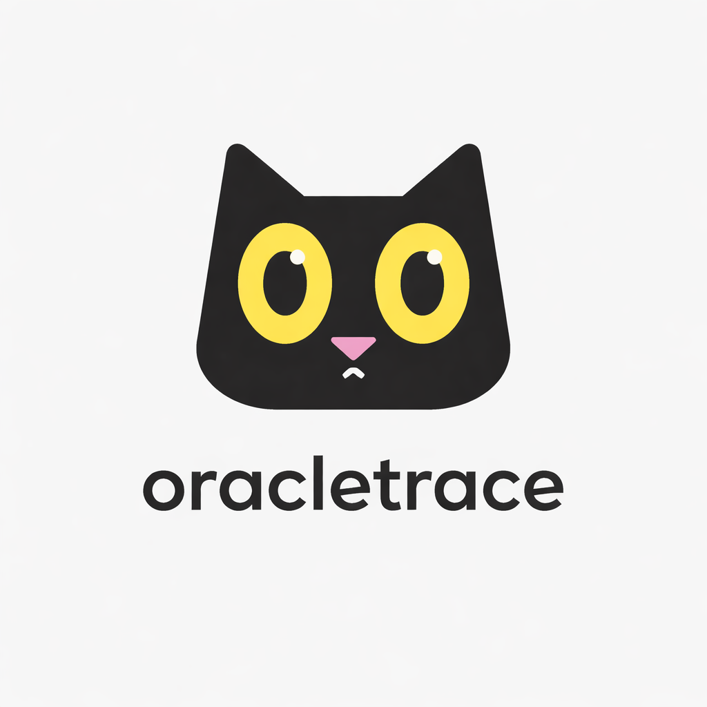

title: OracleTrace Documentation
description: Add CI performance regression guardrails to Python projects with execution tracing, JSON baselines, and call graph output.
keywords: oracletrace, oracle trace, python oracle trace, python profiler, lightweight python profiler, performance regression detection, python performance regression, execution trace, execution tracing tool, call graph visualization, function timing analysis, ci performance checks, benchmark comparison, trace comparison, terminal profiler, developer tooling, cat logo, blackcat logo, black cat profiler
og_title: OracleTrace Documentation
og_description: Detect Python performance regressions with execution tracing, JSON baseline comparison, and call graph visualization.

# OracleTrace: CI Performance Regression Guardrails

<div class="hero" markdown>



**OracleTrace** helps Python teams catch slowdowns before merge by tracing function calls, saving baselines, comparing current runs, and failing CI when regressions exceed your threshold.

[Get started in 2 minutes](quickstart.md){ .md-button .md-button--primary }
[Install OracleTrace](installation.md){ .md-button }

</div>

## What is OracleTrace?

OracleTrace is a lightweight Python execution tracing tool built for practical performance regression checks in local development and CI.

Use it to:

- Detect performance regressions between script versions
- Compare baseline and new trace runs
- Save and compare named baseline files
- Inspect per-function timing and call counts
- Visualize caller to callee flow with a readable tree
- Automate performance checks in CI pipelines

## Why use it instead of a heavy profiler?

Most profilers are great for deep optimization work. OracleTrace is focused on quick day-to-day regression checks that fit into pull request workflows.

You get fast answers to questions like:

- What became slower after this change?
- Which function improved?
- Did new calls appear in this run?

## Core features

### Performance comparison

Compare two JSON traces and instantly spot:

- Slower functions
- Faster functions
- New functions
- Removed functions

### Execution trace metrics

For each function:

- Total execution time
- Call count
- Average time per call
- Caller and callee relationships

### Call graph visualization

Understand execution flow at a glance through a structured logic tree.

### JSON export for automation

Store results and plug them into:

- CI performance gates
- Historical regression tracking
- Custom analysis scripts

### Baseline management

Create stable references and compare saved traces without rerunning the baseline:

```bash
oracletrace baseline save my_app.py baseline.json
oracletrace baseline compare baseline.json current.json --fail-on-regression --threshold 35
```

### CSV export for reporting

Export flat metrics for spreadsheet workflows and external dashboards.

### Regression gates for CI

Use `--fail-on-regression` and `--threshold` to fail builds only when slowdowns pass your tolerance.

## Quick command preview

```bash
oracletrace my_app.py
oracletrace my_app.py --json baseline.json
oracletrace my_app.py --json new.json --compare baseline.json
oracletrace my_app.py --json new.json --compare baseline.json --fail-on-regression --threshold 35
oracletrace baseline compare baseline.json new.json --fail-on-regression --threshold 35
```


## How OracleTrace works

OracleTrace uses Python's built-in `sys.setprofile()` hook to capture `call` and `return` events, then aggregates function-level timing and call relationships.

It filters out non-project code so output stays focused on what you actually own.

## When to use another tool

Use OracleTrace when you need a fast regression signal for scripts, tests, and CI gates. Use `cProfile`, `py-spy`, or benchmark frameworks when you need deep profiling statistics, production process sampling, memory analysis, or rigorous microbenchmarking.

## Next steps

- [Installation guide](installation.md)
- [Quickstart tutorial](quickstart.md)
- [CLI reference](cli-reference.md)
- [Practical examples](examples.md)


